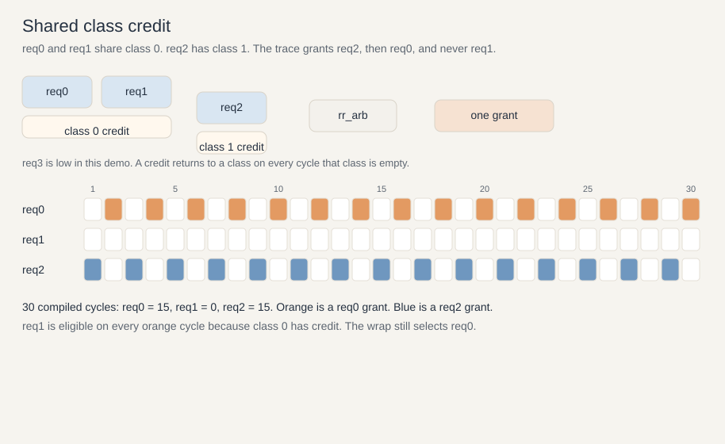

# RTL property review

Give existing RTL and a property to an AI coding tool. The useful result is a counterexample. Compile the RTL and reproduce that trace.

A property states what the design must do. Start from a general property for that kind of block. Keep it, change the wording for your design, or set it aside. The tool maps those words onto the signals in the RTL. One property is checked at a time.

A run that stays clean for 30 cycles, or 100, does not prove the property. The next cycle can still fail. A counterexample trace shows the failure.

This repository is the first demonstration of that flow. The design is small on purpose: a round-robin arbiter whose local grants are correct, while one request is never granted.



## Flow

1. Choose a property for the kind of block, such as: a request that stays asserted is eventually granted while the credit it needs continues to be supplied.
2. Change that property where the design is allowed to behave differently.
3. Give the RTL and that one property to Cursor or another AI coding tool.
4. The tool names the RTL signals it used for the terms in the property.
5. If the property fails, the tool returns a counterexample.
6. Compile the RTL and check that trace.

No separate verification environment is required for this review. The compiled trace is still the evidence.

## This example

`req0` and `req1` share one credit pool. `req2` has a credit pool of its own. Both pools are refilled on every cycle they are empty. The arbiter grants `req2`, then `req0`, and that pair repeats. `req1` stays asserted, and it is eligible on every class-0 cycle, but it never receives a grant.

The properties that hold:

- No grant without an eligible request.
- No grant when that requester's credit is empty.
- At most one grant.
- Round-robin among the requesters that are eligible on that cycle.
- A requester with no credit does not prevent a grant to an eligible requester.

The property that fails:

- A request that stays asserted is eventually granted while its credit continues to be supplied.

`req1` stays asserted and class-0 credit keeps returning. The two-cycle loop never grants `req1`.

## Design

`rtl/rr_arb.v` is a four-requester round-robin arbiter. A request is eligible when `req` and `req_en` are both high. The grant is combinational and one-hot. The round-robin pointer advances when a grant is issued. After the highest index wins, the pointer wraps and the next grant is the lowest eligible requester.

`rtl/rr_arb_shared_credit.v` instantiates that arbiter. `req_en` comes from the credit registers:

| Requester | Eligible when |
|---|---|
| `req0` | class 0 credit is greater than 0 |
| `req1` | class 0 credit is greater than 0 |
| `req2` | class 1 credit is greater than 0 |
| `req3` | class 2 credit is greater than 0 |

A grant spends one credit from that class. `credit0`, `credit1`, and `credit2` each return one credit. A return and a spend on the same edge leave that class unchanged. Reset clears the pointer and all three credit registers.

## Counterexample

`rtl/tb_rr_arb_shared_credit.v` holds `req0`, `req1`, and `req2` high. It loads one class-1 credit, then returns a credit to class 0 or class 1 on every cycle that class is empty.

The compiled result over 30 cycles is `req0 = 15`, `req1 = 0`, `req2 = 15`. The cycle values are in `trace/rr-arbiter-shared-credit-trace.txt`. In the `gnt` column, bit 0 is `req0`, so `0100` grants `req2` and `0001` grants `req0`.

Cycle 1 grants `req2` and moves the pointer above it. Cycle 2 has class-0 credit, so `req0` and `req1` are both eligible. The pointer is above them, the scan wraps, and `req0` is granted. Class 0 is empty again. The same two cycles repeat.

## Run

Using Icarus Verilog from the repository root:

```
iverilog -g2012 -o sim.out rtl/rr_arb.v rtl/rr_arb_shared_credit.v rtl/tb_rr_arb_shared_credit.v
vvp sim.out
```

The testbench writes a new `rr-arbiter-shared-credit-trace.txt` in the current directory and prints `PASS` when the counts are 15, 0, and 15.
